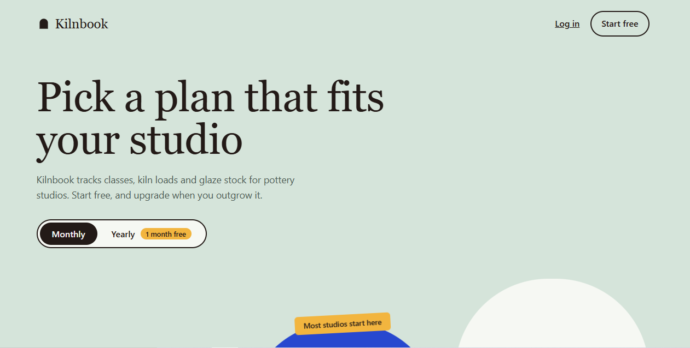

# Pricing Page
 
A pricing page with a monthly/yearly billing switch and an FAQ accordion, built with plain HTML, CSS and JavaScript. The product, Kilnbook, is made up, so all the names, prices and policies are placeholders.



## What it does
 
- Switch between monthly and yearly billing, and the prices count up or down to the new numbers
- Each plan shows what you'll be billed, and the free plan says it's free
- An FAQ accordion with one answer open at a time
- Responsiveness on other devices


## Run it locally
 
```bash
git clone https://github.com/Funexlite/pricing-page.git
cd pricing-page
```
 
Then open `index.html` in your browser. There's nothing to install.


## How it works
 
- **Prices live in the HTML.** Each price has `data-monthly` attributes, and the script reads them. To change a price, I only edit the HTML.
- **The count animation** uses `requestAnimationFrame` with an easing curve. A new animation cancels the one still running if you click quickly, and it's skipped for people who prefer reduced motion.
- **Screen readers** get the final price in a hidden text element, so they don't hear numbers counting up. A status message announces which billing period is showing.
- **The accordion** uses buttons with `aria-expanded` and `aria-controls`. Closed answers are marked `inert`, so they can't be tabbed into. 
- **The plans stand on a shelf.** They are arch-shaped and different heights, which fits the pottery theme.


## What I learned
 
- Animating numbers with `requestAnimationFrame`
- Building an accessible accordion and switch
- Animating height with CSS grid
- Designing around a subject instead of a template


## Next

- Add a plan comparison table
- Rebuild it in React
